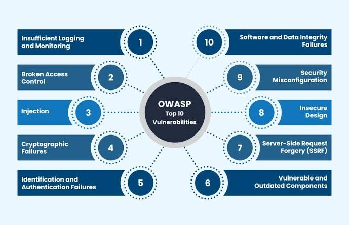

# Darkly

This repository is a 42 project that asked us to find security breaches on a website.

The objective was to find 14 breaches, each of them giving a flag.

For each breach, we wrote how we found it, how the breach can be exploited and how the breach can be avoided.

At the root of the repository, we created a directory for each breach containing the flag.
